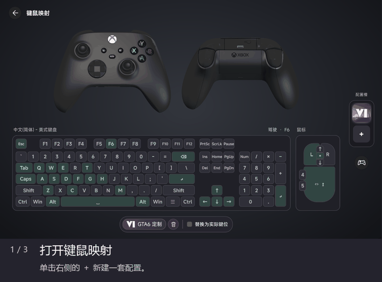

# Series Relay Launcher 用户指南

Series Relay Launcher 是 Windows x64 上的游戏实例启动器。把已有的 Xbox Series 构建导入游戏库后，你可以为每个实例选择运行引擎、配置输入，在大厅查看启动状态、游玩记录和成就。**内置预设适配 CYBERLEEK · v1.0.2.1**。下文的专用键位、HUD 提示和成就目录均以这个构建为准。

**[下载 Windows 便携版 v1.0.3](https://github.com/Pumo-Ayla/series-relay-launcher/releases/download/v1.0.3/Launcher-1.0.3.zip)** · [最新发行版](https://github.com/Pumo-Ayla/series-relay-launcher/releases/latest) · [逐版更新说明](Updates/RELEASE.md) · [开发者指南](docs/DEVELOPMENT.zh-CN.md)

## 第一次启动

1. 将启动器 ZIP 完整解压到可写目录，双击 **`SRLauncher.exe`**。首次界面为英文。点击右上角齿轮，在语言选项里选择「简体中文」。
2. 点击左侧 **＋**，选择「本地目录导入」或「磁力链接导入」。如果你持有 **CYBERLEEK · v1.0.2.1**，可同时选中下方的同名预设。它会填好实例名称、图标、详情卡和大厅外观。
3. 选取自己的游戏目录或输入磁力链接，点击「检查」。按页面提示补齐游戏 EXE 或指定其来源。检查结果会留在当前页面，方便你核对。预设流程检查通过后点「完成」，自行配置则点「下一步」编辑详情卡和大厅背景。
4. 回到大厅，选择实例。下载或解压尚在进行时可以查看安装状态。等待启动按钮显示「启动游戏」后点击。

| 手头的文件 | 导入时怎么选 |
| --- | --- |
| 已解压的游戏目录 | 选择游戏资源所在目录。启动器检查清单、必要资源和 EXE。 |
| 单个压缩包或分卷归档 | 将分卷放在同一目录，让启动器识别主卷，选好解压目标目录。「标准解压」保留原包，可从头重试。 |
| 磁力链接 | 检查下载源后，根据文件清单区分散装文件和压缩包。归档需要设置解压目录，安装进度会在入库后显示。 |
| 游戏 EXE 单独存放 | 在 EXE 来源页面指定本地文件或界面支持的压缩包、磁力链接。版本匹配时也可以从内置列表选取。 |

**磁盘空间紧张时**可以选「解压并删除源分卷」。已经删除的卷无法用于重试。中断、断电或校验失败后，可能需要重新下载。只有另有备份或能重新取得源文件时再确认。

## 用键盘和鼠标游玩

在左下角**长按输入图标**切换到键鼠模式，再**单击**打开「键鼠映射」。使用内置键位时，选中带 VI 标识的预设即可。想改键时，点配置槽的 **＋**，跟随手柄上高亮的按钮逐项录入。录入鼠标键时，把指针放在白色输入框内。完成最后一项后保存，可在配置槽之间切换。

内置键位按步行和驾驶分层。按 **F6** 切换两层，避免同一个按键在错误的场景触发。

| 场景 | 常用操作 |
| --- | --- |
| 步行 | WASD 移动，鼠标右键瞄准，左键射击。 |
| 驾驶 | W 加速，S 制动，A / D 转向，空格手刹。 |
| 查看绑定 | 在映射页切换手柄与键盘视图，查看当前方案及按键反馈。 |

### 让游戏内提示显示实际键位

在此预设下选择 **cool_fox（CGBJ）**，启用键鼠模式并选中一套完整配置。在映射页勾选 **「替换为实际键位」**（英文为 **Show bound keys in game**），等「正在准备键位提示」结束后启动。支持的操作提示会显示实际绑定，例如瞄准显示鼠标右键，跳跃显示空格。改绑后请退出游戏，让启动器按新方案重新准备。

游戏 HUD 中的手柄按钮会重绘成键帽，帮助文字里的操作标记也会随之替换。处理范围取决于该构建的图标库和文本资源。v1.0.3 通过 CGBJ 引擎应用自定义映射和 HUD 重绘。

## 查看成就与游玩记录

展开大厅左下角的游戏详情卡，可以查看游戏进度、游玩时长、上次启动时间和成就记录。**单击成就卡**可展开名称、达成条件以及已记录的首次达成时间。未完成的卡片显示已记录的进度，已完成的卡片带勾。

游玩期间，**SR Achievement Event Monitoring System** 会读取当前实例的本地运行事件。首次观察到更高进度时显示进度提示，达到 100% 时显示完成通知。这个预设的目录共 **55 项**。记录归属于当前启动器实例，显示的是本机观察到的进度。

## 引擎、预热与故障排查

| 你看到的情况 | 可以做什么 |
| --- | --- |
| 想切换运行引擎 | 从大厅的「启动选项」选择当前实例提供的引擎。CYBERLEEK 预设对应 cool_fox 和 VIctory-NVIDIA，通用配置使用 XCL。发行包所用的具体提交见[模拟器清单](Emulators/catalog.json)。 |
| 启动按钮显示「管线预热」 | 查看按钮的预热详情。「缓存中的着色器」是着色器数量，「已处理管线」是本轮已经处理和待处理的渲染管线数。二者计数对象不同。重复启动仍可能有管线准备阶段，请以本次进度为准。 |
| 想调整画质或插帧 | 打开所选引擎的渲染设置。可用的超分辨率、帧生成和倍率由引擎版本与显卡共同决定。项目首页记录了各代硬件的限制，仓库内的引擎版本由发行清单固定。[VIctory-NVIDIA 上游说明](https://github.com/trustno1-coder/VIctory-NVIDIA) |
| 启动器提示缺少运行组件 | 打开「设置 → 运行环境 → 检测」。启动器按内置组件索引校验文件，并尝试从本地组件库恢复缺失或损坏的组件。若仍有错误，点右上角终端图标查看实时日志。 |
| 反馈黑屏、卡在预热或成就未记录 | 在实时日志里选择「导出当前日志」。附上启动器版本、实例预设、引擎、显卡、出错步骤和时间。预热问题可同时附同一轮的 `prewarm.log`。分享前可遮去个人路径和账号信息。 |

## 下载与更新

通常只需下载启动器全量包。需要单独部署引擎时，可下载[同版本模拟器包](https://github.com/Pumo-Ayla/series-relay-launcher/releases/download/v1.0.3/SR-Emulators-1.0.3.zip)。启动器会统计从本机版本到最新版本之间的**每一项**更新。全为普通更新时可以跳过，途中只要有关键更新，就会提示安装最新全量包。例如从 1.0.1 升级到 1.0.3，会同时识别 1.0.2 的关键更新与 1.0.3 的普通更新。[版本历史](Updates/history.json) · [旧版离线升级方法](docs/DEVELOPMENT.zh-CN.md#旧版离线升级)

## 贡献者与许可

| 贡献者 | 工作 |
| --- | --- |
| [Pumo-Ayla](https://github.com/Pumo-Ayla) | 项目维护、产品设计与发行 |
| [ OpenAI Codex](https://github.com/codex) | 开发协作与技术文档 |

本项目原创且有权授权的代码和文档采用 [CC BY-NC 4.0](LICENSE)。模拟器、运行库、游戏素材和商标遵循各自权利人的许可。各引擎的来源、提交和随附许可可从[模拟器清单](Emulators/catalog.json)和[上游源码目录](Source/Community)查阅。
