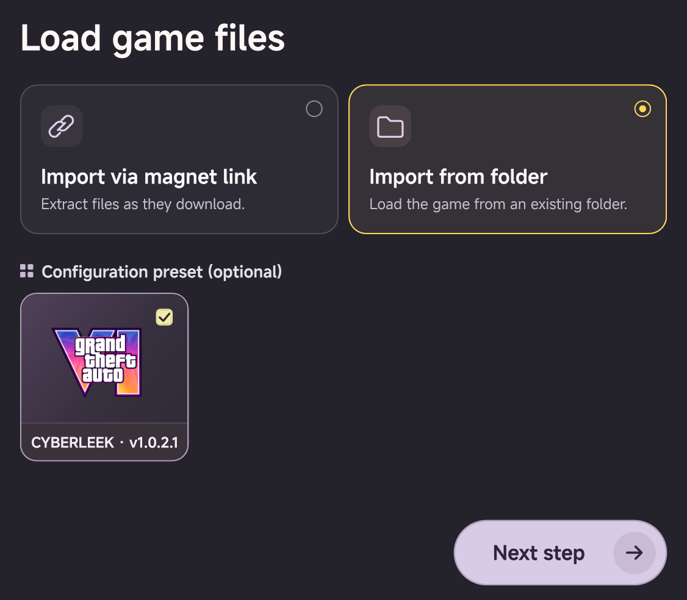
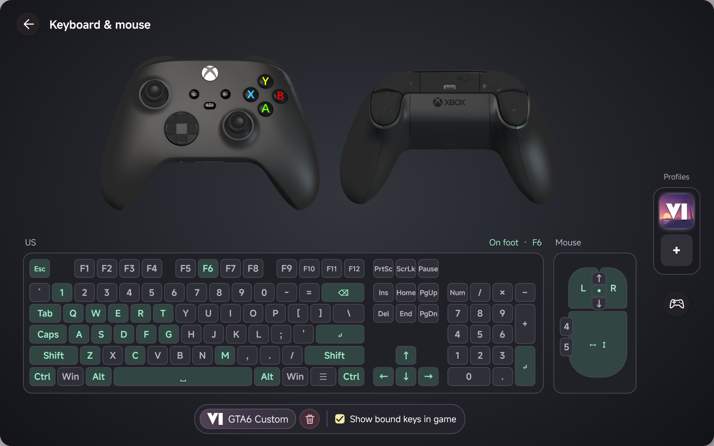

# Series Relay Launcher

English · [简体中文](docs/GUIDE.zh-CN.md) · [繁體中文](docs/GUIDE.zh-TW.md) · [日本語](docs/GUIDE.ja.md) · [한국어](docs/GUIDE.ko.md)

A portable Windows x64 launcher for managing Xbox Series game instances. Import your own game files, choose a compatibility layer, configure controls, and keep saves, play history and local achievements in your library.

**[Download the complete Windows build · v1.0.4.2](https://github.com/Pumo-Ayla/series-relay-launcher/releases/download/v1.0.4.2/SRLauncher-1.0.4.2.zip)** · [Release notes](Updates/RELEASE.md) · [Further Development Notes](docs/DEVELOPMENT.md)

## Supported emulators and compatibility layers

| Included layer | Instance profile | Features exposed by this launcher |
| --- | --- | --- |
| cool_fox (CGBJ) | Independently optimized | Built-in and custom keyboard/mouse mappings, in-game keycap rendering, shader and pipeline warmup, local achievements |
| VIctory-NVIDIA | Independently optimized | Native preload, rendering controls, hardware-dependent DLSS or FSR frame generation, local achievements |
| XCL (Xbox Series X\|S) | General XCL profile | General launch path, XCL shader preparation and native-format save management. Title compatibility depends on the engine. |

The project card shows whether the selected layer supports achievements. Its upstream repository, pinned revision and distribution are listed in the [engine catalog](Emulators/catalog.json).

Compatibility layers proposed for testing go in the [candidate directory](Emulators/Candidates/).

## Independently optimized titles

| Preset | Target build | What the preset configures |
| --- | --- | --- |
| **CYBERLEEK · v1.0.2.1** | Xbox Series build v1.0.2.1, manifest TitleId `7952987A` | Library name, icon, detail card, lobby artwork and access to cool_fox and VIctory-NVIDIA. Supply the matching game data during import. |

## How to load a game

### Open the import wizard

1. Extract the **launcher** ZIP into a writable folder. Keep its subfolders together and double-click **`SRLauncher.exe`**. A fresh installation opens in English. The gear at the top right contains the interface language setting.
2. Click **＋** near the bottom of the left rail. The three-dot tile represents the new instance while you configure it.
3. Under **Load game files**, select **Import from folder** for a local installation or a directory of archives, or **Import via magnet link** for a torrent. If your files match **CYBERLEEK · v1.0.2.1**, you can also select that preset below the two source cards. Click **Next**.
4. Follow the path below that matches your files. Keep the launcher directory, the folder containing your game or source volumes, and the destination for newly extracted files distinct when choosing paths.

### A. I already have an extracted game folder

1. Open the folder picker and locate **`MicrosoftGame.Config`**. For example, if it is in `D:\Games\Example\GameData\MicrosoftGame.Config`, select `GameData` or its immediate parent `Example`. Selecting an entire drive or a library several levels above the manifest will not locate the game.
2. Click **Check**. For the optimized build the launcher reads the manifest and the headers of `common.rpf`, `shaders.rpf`, `levels.rpf` and `textures.rpf`. If a file is named in the error, check both its location and whether the download or extraction finished.
3. When asked whether the game includes its executable, choose **Yes, find it automatically** if it is in the location declared by the manifest. For an external copy choose **Provide the EXE separately**, then browse for **your own EXE** or select the matching item in **Bundled EXE**. The usual executable name for this build is `game_scarlett_master.exe`.
4. Click **Check** to validate the executable against the data. A successful check leaves the result on screen. With the preset, click **Finish** to add the instance. With a custom presentation, click **Next**, complete the card and lobby steps below, then finish. This instance uses the selected files in place.
5. Select the new tile in the library. Wait for warmup and click **Play**.

### B. I have a ZIP, 7Z, RAR or multipart archive

1. Choose **Import from folder** and select the directory **containing** the archive. For a multipart set, keep every volume together with its original name. In a set named `Example.part01.exe`, `Example.part02.rar` and `Example.part03.rar`, the first file is the self-extracting archive header. Select the folder in the launcher instead of running that EXE.
2. Click **Check**. The wizard shows the detected archive and volume count. If several archives are present, choose the intended archive or first volume. Replace missing volumes before continuing.
3. Answer the executable question. Choose automatic discovery if the archive includes the game program. If you have a data-only archive, supply a separate EXE, a local ZIP/RAR/7Z containing it, or the matching bundled EXE.
4. Select an extraction mode **and an existing writable destination directory**. **Extract and keep originals** retains the source for a retry. The source-volume deletion option can release a fully consumed RAR volume when the next one opens. A single source archive can be deleted once extraction completes and a game manifest is found. A later failure or interruption can require downloading deleted volumes again. The deletion option requires explicit confirmation.
5. Finish the source check and add the instance. **Source checked. Install from the library.** means that an installation plan has been saved. Select the new tile and click **Extract and install**. After the extracted files and EXE pass validation, the instance enters warmup. Click **Play** when ready.

### C. I have a magnet link

1. Choose **Import via magnet link**, paste the complete `magnet:?` URI and click **Check**. During source inspection, the launcher retrieves torrent metadata and examines the file list.
2. A file list containing `MicrosoftGame.Config` takes the loose-file path. A list containing a supported archive without a visible manifest takes the archive path. At this point you may still need to tell the wizard whether the executable is inside.
3. Choose automatic EXE discovery or provide it separately. The magnet workflow also accepts a second magnet link or an HTTP(S) direct file URL for an EXE or EXE archive. A download landing page is unsuitable as a file source.
4. Choose the output directory. An archive source also asks for the extraction mode and, for source deletion, consent. Finish adding the instance, return to the library and click **Start download**. An archive torrent downloads its source files to the destination before extraction. Allow space for the archive and the extracted output.
5. If inspection times out after 60 seconds, check for an online source of metadata. A 90-second data timeout during transfer concerns the requested data. Open the install button's menu to inspect the destination or cancel an active transfer. After installation and warmup, click **Play**.

### Customizing the instance

The built-in preset skips the card and lobby editors. For a custom instance, enter a name and click the icon next to it to choose artwork. The first character of the name supplies the fallback icon. The detail cover and logo accept PNG, JPEG and BMP. Drag the logo to position it or drag its corner to resize it. Switch among the fresh, played and achievements previews to check how much of the cover the data occupies.

Choose the launcher configuration. Under **Independently optimized**, select the actual version row as well as the profile card. Click **Check** to verify the selected runtime files, then **Next**. In the lobby editor you can select background artwork or keep the default. Click **Finish** to save. For pending downloads and archives, continue with the install button in the lobby.

## Keyboard, mouse and in-game prompts

Long-press the **input icon** at the bottom left to switch between controller and keyboard/mouse modes. In keyboard mode, a single click opens mapping. On CGBJ, select the built-in VI profile to use the bindings below, or click **＋** in the slot rail to create your own.

| Built-in context | Controls |
| --- | --- |
| On foot | WASD to move, right mouse to aim, left mouse to fire, Shift to sprint, Space to jump. |
| Driving | F6 switches between on-foot and driving layers. W accelerates, S brakes, A/D steer, Space applies the handbrake. |
| Menus and shortcuts | Arrow keys navigate, Enter confirms, Backspace goes back, Esc opens pause. Hold Alt for character switching. |

The custom wizard presents 18 controls, including face buttons, triggers, shoulders and stick clicks. Press the keyboard key for the highlighted control, or press the mouse button inside the white capture field. Check the captured value and advance. Click the value to record it again. WASD is reserved for movement. Save the final control, then select your profile. The keyboard view lets you inspect the active bindings.

**To change what appears on the game HUD**, select the matching optimized instance, CGBJ, keyboard mode and a complete mapping. Enable **Show bound keys in game** on the mapping page. Wait for key prompt preparation before playing. Supported button artwork becomes a keycap, and supported text prompts use the same action binding. For example, aiming can display RMB. Close the game before changing this option or the active mapping. Each supported resource is prepared in a session copy.

## Reading the lobby and managing saves

| Indicator | Meaning and next action |
| --- | --- |
| White rail marker, three dots | Import draft. Continue the wizard or exit to return to the prior instance. |
| Blue | Download or extraction in progress. The install button shows the active stage. |
| Yellow | Shader or pipeline preparation. Open the button details for the current count. |
| Green | Ready to play or currently running. The running instance keeps its marker when you browse another tile. |
| Red | Currently unavailable. Check the instance, selected engine, files and latest log. |

v1.0.4 has separate notifications for installation completion, preload start, preload completion and successful game start. The final notification follows the first reported frame. You can browse the library during play. The launcher permits one active game session.

Open the detail card at the lower left to see story progress, time played and the last launch. For backups, open the save library under the launch options. Exit the game, select the desired slot, then use **Export save** to create a ZIP. **Import save** adds an external slot. XCL uses its own save layout. The selected slot determines the data presented at the next launch.

Right-click an instance to remove it. **Remove launcher instance only** keeps the game files and saves. The option to remove the instance together with its files shows the target directory before confirmation. It is disabled for shared game directories and protected locations.

### Test a controller and read project benchmarks

In controller mode, click the input icon to open the live input test. Press buttons, move both sticks and squeeze each trigger to check their response. Controllers that report motion sensors can also drive the orientation preview. Enable **Show reported frame rates** in Settings to see the upstream project’s test scene and frame rate on its card. Those measurements belong to the hardware and scene listed by that project.

## Achievements

Click the grid icon beside **Achievements** to see one square per achievement, ordered by numeric ID. Each unlocked square uses its trophy color. A dark square is still locked, including achievements with partial progress. Hover over a square for its ID, name and status. Click the list icon to return to the cards.

Open **Settings → Notification sounds** to preview a sound or choose **Silent** for each event. Progress updates are silent by default. Unlocks use the achievement chime. Installation, preload start and completion, game startup, confirmation prompts and failures each have their own sound. The master switch mutes all cues and remembers your selections. Controller connection and disconnection each have a separate cue. Each popup shows the controller name.

**SR Achievement Event Monitoring System** records supported events for the current instance. The optimized catalog contains **55 entries**. Click a card to expand its condition and recorded completion time. Increasing progress can trigger a notification. Completion adds a check mark. An achievement-service query alone leaves progress unchanged.

The displayed story percentage comes from readable save data, while achievement percentages come from recorded runtime events. Restoring a save or switching instances can give the two views different histories.

## Rendering, warmup and troubleshooting

- **Choosing an engine.** Open the menu beside Play and choose an engine offered for the instance. Hover over its project card for achievement support and available upstream measurements. Report the engine and revision when comparing results.
- **Understanding warmup.** Cached shaders count shader programs. Processed pipelines count combinations of shaders and rendering state on this run's worklist. A nonzero shader cache and a fresh pipeline counter can appear together. VIctory-NVIDIA starts its native preload with the selected rendering settings. Check the stage and `prewarm.log` before deciding to clear a cache.
- **Upscaling and frame generation.** The VIctory-NVIDIA settings expose the console profile, DLSS mode and frame generation choices according to the detected capabilities. Changing one can reduce the permitted multiplier. Generated display frames and native game frames are different measurements. The pinned engine version is in the [catalog](Emulators/catalog.json).
- **Runtime environment.** Open **Settings → Runtime environment → Check**. The launcher verifies indexed components and can restore missing or damaged files from its bundled library. The checks cover the launcher, helper runtimes, transfer engine and selected engine builds. Manage GPU drivers separately.
- **Reporting a problem.** Right-click the terminal icon and choose **Export full diagnostic log**. Send the resulting `SR-Diagnostics-*.log`. It includes the current and previous launcher sessions, the engine logs for their recorded attempts, hardware and drivers, and download, component and update diagnostics.

## Updates and downloads

**Fresh installation.** Download [SRLauncher-1.0.4.2.zip](https://github.com/Pumo-Ayla/series-relay-launcher/releases/download/v1.0.4.2/SRLauncher-1.0.4.2.zip), extract the entire ZIP into a writable folder and open `SRLauncher.exe`. A clean installation opens in English.

**Upgrading 1.0.4 or earlier.** The existing updater recognizes three-part tags and cannot discover this four-part version. Download [SRLauncher-1.0.4.2-offline.zip](https://github.com/Pumo-Ayla/series-relay-launcher/releases/download/v1.0.4.2/SRLauncher-1.0.4.2-offline.zip) and extract it into a temporary folder. Leave the full launcher ZIP inside it packed. Close the game and launcher, run `Upgrade-Launcher.exe` and enter the existing folder that contains `SRLauncher.exe` or `Launcher.exe`. When the tool reports completion, reopen the launcher from that original folder. Your registered games, settings and saves are preserved.

**Updates from 1.0.4.1 onward.** The launcher checks once at startup and once per click on **Check for updates** in Settings. Downloads and retries use the verified release information from that check. The launcher verifies the downloaded package size and SHA-256. This release is optional.

**Source code (zip)** on the release page contains the tagged source tree for rebuilding. [Further Development Notes](docs/DEVELOPMENT.md)

## License

Original code and documentation that the project can license are available under [CC BY-NC 4.0](LICENSE). Third-party engines, runtimes, game artwork and trademarks are subject to their respective terms. See the [engine sources and licenses](Source/Community).
