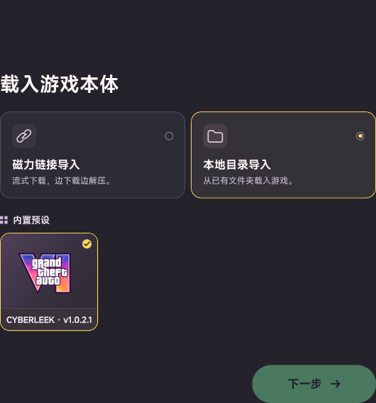
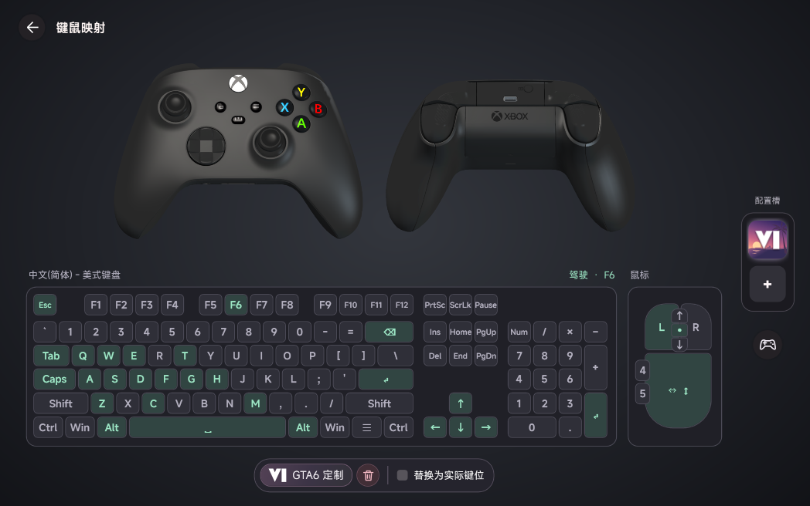

# Series Relay Launcher 利用ガイド

[English](../README.md) · [简体中文](GUIDE.zh-CN.md) · [繁體中文](GUIDE.zh-TW.md) · 日本語 · [한국어](GUIDE.ko.md)

Windows x64 向けのポータブルランチャーです。手元のゲームデータをライブラリに登録し、インスタンスごとに実行環境、入力、セーブ、プレイ履歴を管理します。[v1.0.4 をダウンロード](https://github.com/Pumo-Ayla/series-relay-launcher/releases/download/v1.0.4/Launcher-1.0.4.zip) · [開発者ガイド](DEVELOPMENT.ja.md)

## 対応エミュレーター・互換レイヤー

| レイヤー | プロファイル | 主な機能 |
| --- | --- | --- |
| cool_fox（CGBJ） | 個別最適化 | キーボード・マウスの割り当て、ゲーム内キー表示の再描画、ウォームアップ、実績 |
| VIctory-NVIDIA | 個別最適化 | ネイティブのプリロード、描画設定、対応環境での DLSS / FSR フレーム生成、実績 |
| XCL（Xbox Series X\|S） | 汎用 | タイトルの起動、シェーダーの準備、XCL 形式のセーブ管理。動作はタイトルとエンジンに依存します。 |

## 個別最適化プリセット

| プリセット | 対象 | 自動設定 |
| --- | --- | --- |
| **CYBERLEEK · v1.0.2.1** | Xbox Series ビルド、TitleId `7952987A` | 名前、アイコン、詳細カード、ロビー背景、選択可能な専用レイヤー。対応するゲームデータを別途指定します。 |

## ゲームを読み込む

ランチャーの ZIP を書き込み可能な場所にすべて展開し、`SRLauncher.exe` を起動します。初回は英語です。右上の歯車から表示言語を日本語に変更できます。左下の **＋** を押し、ローカルフォルダーかマグネットリンクを選びます。該当するビルドなら、下のプリセットも選んで次へ進みます。

### 展開済みのフォルダー

1. `MicrosoftGame.Config` があるフォルダーを選びます。例えば `D:\Games\Example\GameData\MicrosoftGame.Config` なら `GameData` またはその一つ上の `Example` を指定できます。
2. チェックを実行します。個別最適化ビルドには `common.rpf`、`shaders.rpf`、`levels.rpf`、`textures.rpf` が必要です。特定のファイルで止まったら、選んだ階層とダウンロードの完了を確認してください。
3. EXE が本体に含まれる場合は自動検索を選択します。別の場所にある場合は個別指定に進み、自分の EXE または一致する内蔵 EXE を選択します。このビルドのゲーム実行ファイル名は通常 `game_scarlett_master.exe` です。
4. チェック結果を確認してから、プリセットなら完了、自分で設定する場合は次へ進みます。登録後もこの場所のファイルを使用します。ロビーのボタンが起動可能になったら押してください。

### 圧縮ファイルと分割ファイル

1. ローカルフォルダーの読み込みを選び、ZIP、7Z、RAR の入っている**フォルダー**を指定します。分割形式は全巻を同じ場所に置きます。例えば `Example.part01.exe` は自己解凍形式の先頭巻です。`Example.part02.rar` などの後続巻と一緒にランチャーに読み込ませます。
2. チェック後、複数の圧縮セットがある場合は対象セットの先頭を選択します。ゲーム EXE が中にあれば自動検索を、データだけなら別途 EXE を指定します。
3. 通常展開は元ファイルを保持します。読み取り済みの巻を削除する方式では、次の巻を開く時点で前巻が削除されることがあります。中断後の再試行には削除済みの巻が必要です。方式を選択し、削除する場合は確認に同意したうえで、**展開先フォルダー**を指定します。
4. 登録したインスタンスを選び、ロビーで **Extract and install** に相当するボタンを押します。展開後のファイル確認とプリロードが終わったら起動します。

### マグネットリンク

完全な `magnet:?` リンクを貼り付け、チェックを実行します。メタデータに `MicrosoftGame.Config` が直接含まれる場合は展開済みファイルとして、対応するアーカイブだけが見える場合は圧縮ファイルとして処理します。EXE の有無を回答します。別の EXE はローカルファイル、対応するアーカイブ、直接ダウンロードできる HTTP(S) URL、別のマグネットリンクから指定できます。

出力先を指定し、圧縮形式の場合は展開方法も選びます。ライブラリに追加したら **Start download** に相当するボタンを押します。圧縮セットはダウンロード後に展開されるため、両方を置ける空き容量を確保してください。メタデータが 60 秒で取得できない場合は配布元を、転送中に 90 秒データを受信できない場合は利用可能なピアを確認してください。

### 詳細設定と初回起動

プリセットを使わない場合は名前を入力し、隣のアイコンをクリックして変更できます。カバーとロゴには PNG、JPEG、BMP を指定できます。ロゴはドラッグで移動し、角で大きさを調整します。起動構成を選び、個別最適化ならバージョンの行も選択してください。チェックを通過したらロビー背景を設定して完了します。ライブラリに登録した圧縮・ダウンロード形式では、続けてインストール操作が必要です。

## 入力・HUD・実績

- 左下の入力アイコンを長押ししてモードを切り替え、キーボードモードでクリックして割り当てを開きます。内蔵プリセットは徒歩と運転を **F6** で切り替えます。徒歩は WASD 移動、右クリックで照準、左クリックで射撃。運転は W/S で加速・制動、A/D で操舵、Space でハンドブレーキです。
- 自分の割り当てはスロットの **＋** から作成します。表示される 18 項目に順に入力し、マウスボタンは白い入力欄の中で押します。最後に保存します。CGBJ で設定済みスロットとキーボードモードを選び、**Show bound keys in game** を有効にすると、対応する HUD ボタンとヘルプ文が実際のキー表示になります。変更はゲーム終了後に行ってください。
- 詳細カードを開くとストーリー進行度、プレイ時間、前回起動日時が表示されます。個別最適化プリセットの実績は 55 件。カードをクリックすると条件と記録済みの初回達成日時を確認できます。通知はローカルの実行ログで新しい進捗または達成が観測されたときに表示されます。

コントローラーモードで左下の入力アイコンをクリックすると、ボタン、スティック、トリガーの入力を確認できます。モーションセンサーを備えた機器では姿勢も表示されます。設定の「参考フレームレートを表示」を有効にすると、プロジェクトカードに開発元が報告した測定値とテスト場面が表示されます。

## セーブ・描画・更新

起動オプションからセーブ管理を開きます。ゲームを終了してスロットを選択し、ZIP としてエクスポートできます。バックアップのインポートは外部スロットとして追加されます。XCL は専用の保存形式を使用します。インスタンスを右クリックして登録のみを削除する場合、ゲームとセーブは保持されます。本体も削除する場合は確認画面の対象ディレクトリを確認してください。

プリロードの黄色表示では、シェーダー数と処理済みパイプライン数を個別に確認できます。VIctory-NVIDIA のフレーム生成と倍率はハードウェアと描画設定に応じて選択できる範囲が変わります。起動不能なら設定のランタイム環境チェックを実行してください。不足する同梱コンポーネントを修復できます。問題の報告にはエンジン、ビルド、発生段階と時刻を添え、ライブ・ログから当該ログをエクスポートします。

v1.0.4 は通常更新です。1.0.3 からは通常更新が 1 件、1.0.1 からは重要更新が 1 件と通常更新が 2 件になります。どちらも同じ完全版 ZIP に更新します。[更新履歴](../Updates/history.json) · [エンジン一覧](../Emulators/catalog.json) · [ライセンス](../LICENSE)
