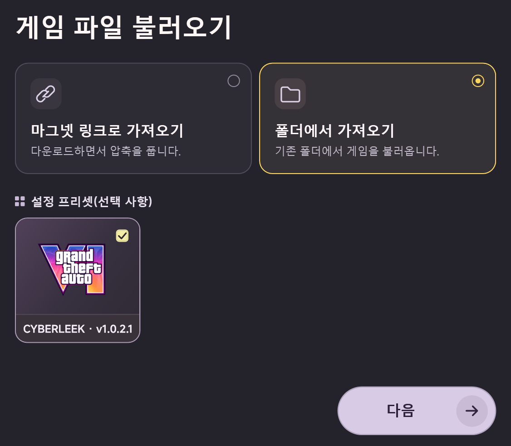
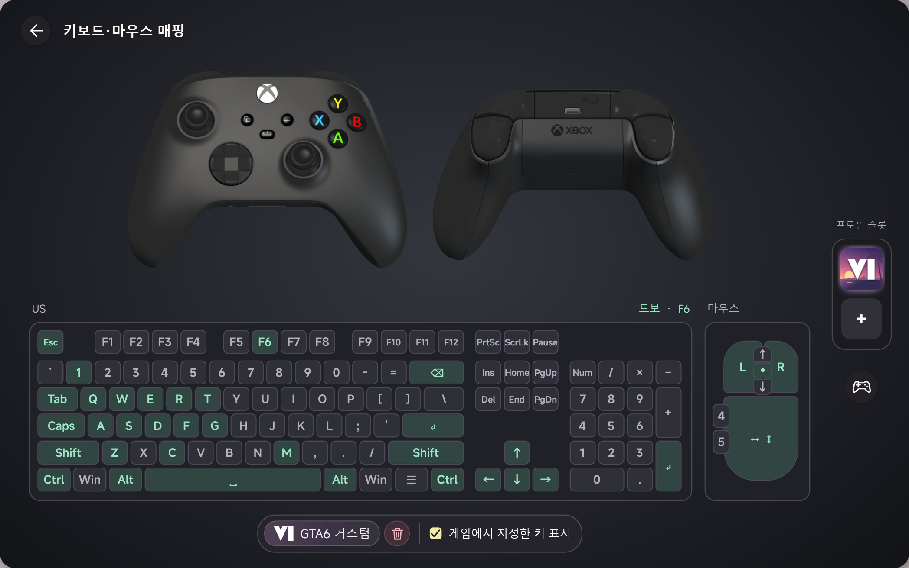

# Series Relay Launcher 사용자 안내서

[English](../README.md) · [简体中文](GUIDE.zh-CN.md) · [繁體中文](GUIDE.zh-TW.md) · [日本語](GUIDE.ja.md) · 한국어

Windows x64용 포터블 런처입니다. 보유한 게임 파일을 라이브러리에 등록하고 인스턴스별로 실행 환경, 입력, 저장 데이터 및 플레이 기록을 관리합니다. [v1.0.4 다운로드](https://github.com/Pumo-Ayla/series-relay-launcher/releases/download/v1.0.4/Launcher-1.0.4.zip) · [후속 개발 안내](DEVELOPMENT.ko.md)

## 지원 에뮬레이터와 호환 계층

| 호환 계층 | 구성 | 런처에서 제공하는 기능 |
| --- | --- | --- |
| cool_fox (CGBJ) | 개별 최적화 | 사용자 지정 키보드·마우스 매핑, 게임 내 키 표시 재구성, 셰이더 및 파이프라인 준비, 로컬 도전 과제 |
| VIctory-NVIDIA | 개별 최적화 | 네이티브 프리로드, 렌더링 설정, 지원 하드웨어에서 DLSS 또는 FSR 프레임 생성, 로컬 도전 과제 |
| XCL (Xbox Series X\|S) | 범용 XCL | 게임 실행, XCL 셰이더 준비, XCL 형식 저장 데이터 관리. 실제 호환성은 게임 빌드와 엔진에 따라 달라집니다. |

## 개별 최적화 게임 목록

| 프리셋 | 대상 빌드 | 자동으로 설정되는 항목 |
| --- | --- | --- |
| **CYBERLEEK · v1.0.2.1** | Xbox Series 빌드, TitleId `7952987A` | 인스턴스 이름, 아이콘, 상세 카드, 로비 배경 및 두 전용 엔진. 해당 게임 데이터의 위치는 직접 지정합니다. |

## 게임 불러오기

런처 ZIP 전체를 쓰기 가능한 폴더에 풀고 `SRLauncher.exe` 를 실행합니다. 처음에는 영어로 표시됩니다. 오른쪽 위 톱니바퀴에서 한국어를 선택할 수 있습니다. 왼쪽 아래 **＋** 를 눌러 로컬 폴더 또는 마그넷 링크를 선택하세요. 해당 빌드를 사용한다면 아래 프리셋도 선택한 뒤 다음으로 진행합니다.

### 이미 압축을 푼 게임

1. `MicrosoftGame.Config` 가 있는 폴더를 선택합니다. 예를 들어 `D:\Games\Example\GameData\MicrosoftGame.Config` 가 있다면 `GameData` 또는 바로 위의 `Example` 을 선택할 수 있습니다.
2. 검사를 누릅니다. 전용 빌드에서는 `common.rpf`, `shaders.rpf`, `levels.rpf`, `textures.rpf` 도 확인합니다. 특정 파일에서 실패하면 선택한 폴더 깊이와 해당 파일의 다운로드 완료 여부를 확인하세요.
3. 게임 EXE가 포함되어 있으면 자동 찾기를 선택합니다. 다른 폴더에 있으면 별도 제공을 선택하고 파일을 찾거나 일치하는 내장 EXE를 고릅니다. 이 빌드에서 게임 실행 파일의 이름은 보통 `game_scarlett_master.exe` 입니다.
4. 검사 결과가 나온 뒤 프리셋을 선택했다면 완료를 누릅니다. 직접 꾸밀 때는 다음을 눌러 상세 카드와 로비를 설정합니다. 등록한 인스턴스는 선택한 위치의 원본 파일을 사용합니다. 로비에서 준비가 끝나면 실행을 누릅니다.

### 로컬 압축 파일 또는 분할 볼륨

1. 폴더에서 가져오기를 선택하고 ZIP, 7Z, RAR가 **들어 있는 폴더**를 지정합니다. 분할 파일은 원래 이름대로 모두 같은 폴더에 둡니다. `Example.part01.exe` 는 자동 압축 풀림 형식의 첫 번째 볼륨일 수 있습니다. 뒤의 `Example.part02.rar` 등과 함께 런처에서 읽도록 합니다.
2. 검사를 누르고, 압축 세트가 여러 개면 원하는 첫 번째 파일을 고릅니다. 게임 EXE가 압축 안에 있다면 자동 찾기, 데이터만 있다면 별도 EXE 제공 또는 내장 EXE를 선택합니다.
3. 표준 압축 해제는 원본을 보관합니다. 읽은 볼륨 삭제 방식을 쓰면 다음 볼륨을 열 때 앞 볼륨이 삭제될 수 있습니다. 작업이 중단되면 이미 삭제된 파일을 다시 받아야 할 수 있습니다. 이 방식은 위험 확인이 필요합니다. 두 방식 모두 쓰기 가능한 **압축 해제 대상 폴더**를 지정합니다.
4. 출처 검사 후 인스턴스를 등록합니다. 로비에서 새 타일의 **Extract and install**에 해당하는 버튼을 눌러 실제 설치를 시작합니다. 압축 해제, 파일 검증과 프리로드가 끝나면 실행합니다.

### 마그넷 링크

전체 `magnet:?` 링크를 붙여 넣고 검사를 누릅니다. 런처는 메타데이터의 파일 목록에서 `MicrosoftGame.Config` 가 보이면 게임 파일 경로로, 지원 압축 파일만 보이면 압축 설치 경로로 진행합니다. 압축 안의 EXE 포함 여부는 직접 답합니다. 별도 EXE는 로컬 파일, 지원 압축 파일, HTTP(S) 직접 다운로드 주소 또는 두 번째 마그넷 링크로 지정할 수 있습니다.

출력 폴더를 고르고, 압축인 경우 압축 해제 방식까지 선택합니다. 라이브러리에 등록한 뒤 **Start download**에 해당하는 버튼을 누릅니다. 압축 세트는 받은 뒤 해제되므로 원본과 결과물을 함께 저장할 공간이 필요합니다. 60초 메타데이터 시간 초과라면 배포 중인 피어를 확인하세요. 전송 중 90초 동안 필요한 데이터를 받지 못한 경우에도 온라인 출처를 확인한 뒤 다시 시도할 수 있습니다.

### 직접 꾸미기와 첫 실행

이름 옆 아이콘을 눌러 교체할 수 있습니다. PNG, JPEG, BMP를 표지와 로고로 선택할 수 있으며, 로고를 끌면 이동하고 모서리를 끌면 크기가 바뀝니다. 실행 구성을 선택합니다. 개별 최적화를 사용할 때는 버전 항목도 선택하세요. 검사 통과 후 다음을 눌러 로비 배경을 정하고 완료합니다. 대기 중인 설치라면 로비에서 다운로드나 압축 설치 버튼을 한 번 더 눌러야 합니다.

## 키보드·마우스와 HUD

입력 아이콘을 길게 누르면 모드가 전환됩니다. 키보드 모드에서 한 번 누르면 매핑 화면이 열립니다. 내장 프리셋에서 F6은 도보와 운전을 전환합니다. 도보는 WASD 이동, 마우스 오른쪽 조준, 왼쪽 사격입니다. 운전은 W/S 가속·제동, A/D 조향, Space 핸드브레이크입니다.

나만의 프로필은 슬롯의 **＋** 로 만듭니다. 강조된 컨트롤에 맞춰 18개 항목을 차례로 입력합니다. 마우스 버튼은 흰 입력 상자 안에서 누릅니다. 각 항목을 확인한 후 다음으로 진행하고 마지막에 저장합니다. CGBJ와 완성된 프로필을 선택하고 **게임에서 지정한 키 표시** 옵션을 켜면 지원되는 HUD 아이콘과 도움말이 실제 바인딩으로 표시됩니다. 변경할 때는 게임을 종료하고 다시 준비하세요.

컨트롤러 모드에서 왼쪽 아래 입력 아이콘을 누르면 버튼, 스틱과 트리거의 반응을 확인할 수 있습니다. 모션 센서를 지원하는 기기는 자세 변화도 표시합니다. 설정에서 참고 프레임 속도 표시를 켜면 프로젝트 카드에 개발자가 보고한 프레임 속도와 측정 장면이 나타납니다.

## 도전 과제, 저장 및 문제 해결

로비 상세 카드를 열면 스토리 진행도, 플레이 시간과 마지막 실행을 볼 수 있습니다. 전용 프리셋의 도전 과제 55개는 로컬 실행 이벤트로 기록합니다. 카드를 누르면 조건과 기록된 최초 달성 시간이 표시됩니다. 스토리 진행률은 저장 데이터를, 도전 과제는 인스턴스의 세션 기록을 사용합니다.

게임을 종료하고 실행 옵션의 저장 관리에서 슬롯을 고르면 ZIP 백업을 내보내거나 가져올 수 있습니다. XCL은 전용 저장 레이아웃을 사용합니다. 인스턴스를 우클릭하여 등록만 해제하면 게임과 저장 데이터가 유지됩니다. 게임 파일까지 삭제할 때는 확인 창에 나온 폴더를 확인하세요.

파이프라인 준비 중에는 버튼에서 캐시된 셰이더 수와 이번 작업에서 처리한 파이프라인 수를 따로 확인합니다. VIctory-NVIDIA의 프레임 생성 방식과 배수는 GPU 및 활성 렌더링 옵션에 따라 달라집니다. 필수 구성 요소 오류는 설정의 런타임 환경 검사로 확인하고 내장 라이브러리에서 복구할 수 있습니다. 문제를 보고할 때는 버전, 엔진, GPU, 실패 시각과 해당 세션의 로그를 함께 제공합니다.

1.0.4는 일반 업데이트입니다. 1.0.3에서 시작하면 일반 업데이트 한 건, 1.0.1에서 시작하면 중요 한 건과 일반 두 건을 계산합니다. 두 경로 모두 같은 최신 전체 패키지를 사용합니다. [버전 기록](../Updates/history.json) · [엔진 목록](../Emulators/catalog.json) · [라이선스](../LICENSE)
