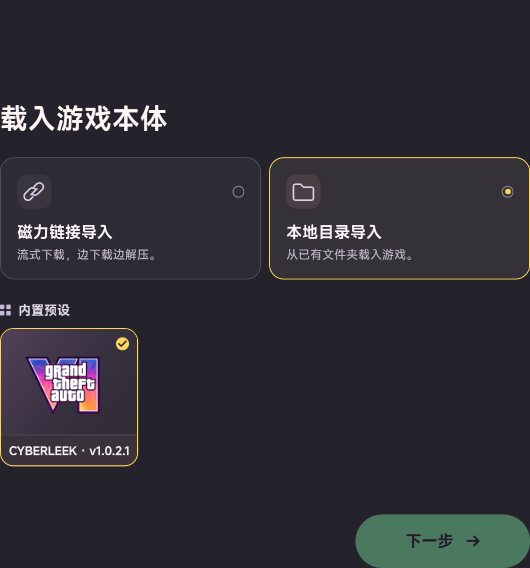
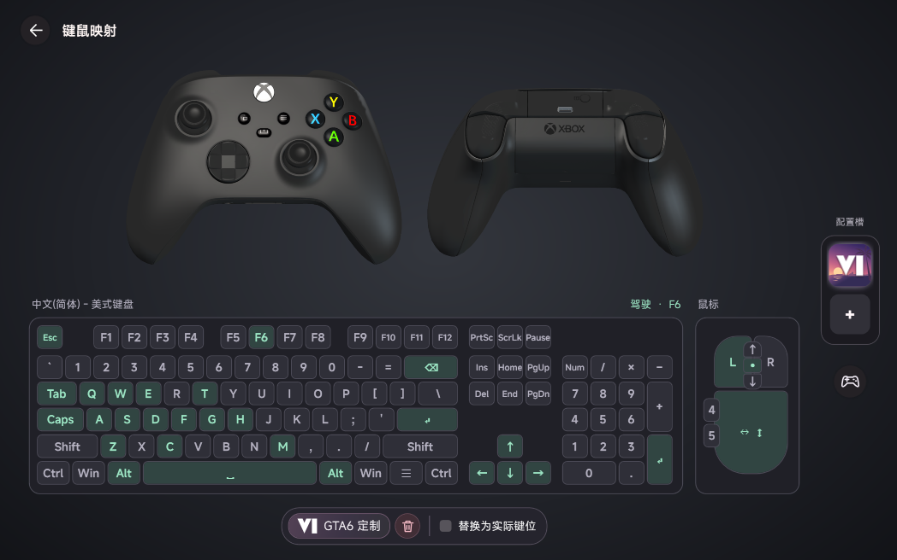

# Series Relay Launcher 用户指南

[English](../README.md) · 简体中文 · [繁體中文](GUIDE.zh-TW.md) · [日本語](GUIDE.ja.md) · [한국어](GUIDE.ko.md)

Series Relay Launcher 是 Windows x64 上的游戏实例启动器。把已有的 Xbox Series 构建导入游戏库后，你可以为每个实例选择运行引擎、配置输入，在大厅查看启动状态、游玩记录和成就。**内置预设适配 CYBERLEEK · v1.0.2.1**。下文的专用键位、HUD 提示和成就目录均以这个构建为准。

**[下载 Windows 便携版 v1.0.4](https://github.com/Pumo-Ayla/series-relay-launcher/releases/download/v1.0.4/Launcher-1.0.4.zip)** · [最新发行版](https://github.com/Pumo-Ayla/series-relay-launcher/releases/latest) · [逐版更新说明](../Updates/RELEASE.md) · [开发者指南](DEVELOPMENT.zh-CN.md)

## 支持的模拟器与兼容层

| 发行包中的引擎 | 在哪里选 | 此版本提供的功能 |
| --- | --- | --- |
| cool_fox（CGBJ） | 独立优化实例的启动选项 | 自定义键鼠映射、游戏内键位重绘、着色器与管线预热、本地成就事件 |
| VIctory-NVIDIA | 独立优化实例的启动选项 | 原生预载、渲染设置、按硬件能力开放的 DLSS / FSR 帧生成、本地成就事件 |
| XCL（Xbox Series X\|S） | 通用实例的 XCL 配置 | 通用启动、XCL 预热及 XCL 存档管理。具体构建能否运行还取决于引擎。 |

## 独立优化游戏列表

| 内置预设 | 对应构建 | 选择后会发生什么 |
| --- | --- | --- |
| **CYBERLEEK · v1.0.2.1** | Xbox Series，清单 TitleId 为 `7952987A` | 自动配置实例的名称、图标、详情卡和大厅，开放 cool_fox 与 VIctory-NVIDIA。游戏资源仍须从自己的目录或下载源载入。 |

## 如何载入游戏

### 打开游戏库并选择来源

1. 将启动器 ZIP 完整解压到可写目录，双击 **`SRLauncher.exe`**。首次界面为英文。点击右上角齿轮，在语言选项里选择「简体中文」。
2. 点击左侧 **＋**，选择「本地目录导入」或「磁力链接导入」。如果你持有 **CYBERLEEK · v1.0.2.1**，可同时选中下方的同名预设。它会填好实例名称、图标、详情卡和大厅外观。
3. 点击右下角「下一步」。左侧三点图标代表正在配置的新实例。在这一页勾选预设后，仍需选择一种导入来源。根据手中已有的文件，按下面对应的步骤继续。

| 手头的文件 | 导入时怎么选 |
| --- | --- |
| 已解压的游戏目录 | 选择游戏资源所在目录。启动器检查清单、必要资源和 EXE。 |
| 单个压缩包或分卷归档 | 将分卷放在同一目录，让启动器识别主卷，选好解压目标目录。「标准解压」保留原包，可从头重试。 |
| 磁力链接 | 检查下载源后，根据文件清单区分散装文件和压缩包。归档需要设置解压目录，安装进度会在入库后显示。 |
| 游戏 EXE 单独存放 | 在 EXE 来源页面指定本地文件或界面支持的压缩包、磁力链接。版本匹配时也可以从内置列表选取。 |

### 已解压的目录

1. 点击「游戏本体目录」旁的「选择」，找到含有 `MicrosoftGame.Config` 的文件夹。例如清单在 `D:\Games\Example\GameData\MicrosoftGame.Config`，可选 `GameData` 或它的直接上一级 `Example`。同一硬盘放有多款游戏时，请选到这一款自己的目录。
2. 点击「检查」。对于本页的独立优化构建，目录还应有 `common.rpf`、`shaders.rpf`、`levels.rpf`、`textures.rpf`。报错里若出现其中一个文件名，先核对选中的层级，再确认文件已完整取得。
3. 在「本体中是否包含游戏 EXE？」选择「包含，自动查找」，再按「检查」。启动器沿游戏清单声明的位置查找程序。若程序另存，选择「另行提供 EXE → 自己的 EXE」并浏览到文件，或选择「内置适配 EXE」后点选对应版本。此构建的游戏程序通常名为 `game_scarlett_master.exe`。
4. 看到「游戏清单、必要资源和 EXE 均符合要求」后再按绿色按钮。已勾选内置预设时按钮为「完成」，直接生成实例。未勾选时为「下一步」，进入详细配置。用已解压目录直接导入时，实例引用所选文件，载入后请保留它们的路径。

### 本地 ZIP、7Z、RAR 或分卷包

1. 仍选「本地目录导入」。在文件夹选择器里选**压缩包所在目录**。例如同目录有 `Example.part01.exe`、`Example.part02.rar`、`Example.part03.rar`，三卷均应保留原名。这里的 `part01.exe` 是自解压主卷，供启动器读取，游戏 EXE 要在后面的步骤单独确认。
2. 点击「检查」。只有一套可识别的归档时会直接显示包名和卷数。若目录有多个候选，在弹出的选择器里选需要导入的主包或第一卷。若首卷缺失或编号有断档，先补齐文件。
3. 回答「本体中是否包含游戏 EXE？」。包内带游戏主程序时选「包含，自动查找」。只有资源包时选「另行提供 EXE」，再选自己的文件、包含主程序的 ZIP / RAR / 7Z，或对应的内置 EXE。
4. 选择「标准解压」并设置**解压目录**，适合需要保留原包或可能重试的情况。若选「解压并删除源分卷」，阅读黄色提示并勾选确认。分卷 RAR 在读取下一卷时可能删除已完整读过的上一卷，单卷包在解压完成并找到清单后才删除。发生断电、取消或校验失败时，重试前可能要重新取得已删除的卷。两种模式都需要选择已存在、可写的目标文件夹。
5. 检查通过后完成入库。看到「来源已检查，入库后安装」表示来源和安装方案已登记。回到大厅，选中新实例，**点击「解压安装」**。等待解压、清单和 EXE 校验完成，随后进入预载。

### 磁力链接

1. 选择「磁力链接导入」，粘贴完整的 `magnet:?` 链接。点「检查」后页面显示「正在检查下载源」。这一步获取种子元数据，读取文件名和目录结构。网页分享地址应先换成实际的磁力链接。
2. 若显示「检测到散装游戏本体」，说明文件清单中直接列有 `MicrosoftGame.Config`。若显示「检测到本体压缩包」，后续会要求选择解压方式与解压目录。仅凭压缩包文件名无法确认包里带有游戏 EXE。
3. 按实际来源选择「包含，自动查找」或「另行提供 EXE」。磁力导入中的「自己的 EXE」还可填写 EXE / 压缩包的 HTTP(S) 直链，或单独的 EXE 磁力链接。填写直链时应指向文件本身；下载到登录页面或文件分享页面会导致格式检查失败。
4. 散装本体在弹窗中选择输出目录。归档则先选标准解压或删除源卷，再选解压目录。完成入库后在大厅点 **「开始下载」**。磁力归档会先下载到目标位置，再按所选策略解压；所需空间应计入下载文件和解压输出。
5. 如果超过 60 秒取不到元数据，先确认链接完整、有在线来源。开始传输后出现「90 秒内未收到所需数据」表示该阶段没有取得所需数据，可检查来源后重试。安装按钮旁的菜单可打开所在文件夹，传输进行时还可取消。

### 自行配置与第一次启动

自行配置时，填写实例名称，点名称旁的图标可更换图标。封面和 Logo 可选 PNG、JPEG 或 BMP。左侧可切换三种数据预览，拖动 Logo 移动位置，拖动角点缩放。使用默认外观也可继续。选择「配置启动器」后点击「检查」；若选择「独立优化」，还需点选版本行。检查通过点「下一步」，在大厅背景页选择图片或保留默认效果，最后点「完成」。

回到大厅后看右下角主按钮。显示「开始下载」或「解压安装」时，**还需要点击它**。显示「管线预热」时可查看详情，等绿色「启动游戏」出现再点击。v1.0.4 会分别提示安装完成、开始预载、预载完成和游戏启动成功；最后一项对应引擎报告的首帧。左侧状态条在导入草稿上为白色、安装中为蓝色、预热中为黄色、就绪或运行中为绿色。红色表示当前实例尚不可启动。游戏运行时可浏览其他实例，状态条留在运行中的实例上。

## 用键盘和鼠标游玩

在左下角**长按输入图标**切换到键鼠模式，再**单击**打开「键鼠映射」。使用内置键位时，选中带 VI 标识的预设即可。想改键时，点配置槽的 **＋**，跟随手柄上高亮的按钮逐项录入。录入鼠标键时，把指针放在白色输入框内。完成最后一项后保存，可在配置槽之间切换。

内置键位按步行和驾驶分层。按 **F6** 切换两层，避免同一个按键在错误的场景触发。

| 场景 | 常用操作 |
| --- | --- |
| 步行 | WASD 移动，鼠标右键瞄准，左键射击。 |
| 驾驶 | W 加速，S 制动，A / D 转向，空格手刹。 |
| 查看绑定 | 在映射页切换手柄与键盘视图，查看当前方案及按键反馈。 |

### 让游戏内提示显示实际键位

在此预设下选择 **cool_fox（CGBJ）**，启用键鼠模式并选中一套完整配置。在映射页勾选 **「替换为实际键位」**（英文为 **Show bound keys in game**），等「正在准备键位提示」结束后启动。支持的操作提示会显示实际绑定，例如瞄准显示鼠标右键，跳跃显示空格。改绑后请退出游戏，让启动器按新方案重新准备。

游戏 HUD 中的手柄按钮会重绘成键帽，帮助文字里的操作标记也会随之替换。处理范围取决于该构建的图标库和文本资源。v1.0.4 通过 CGBJ 引擎应用自定义映射和 HUD 重绘。

**自行录入时**，向导有 18 项，依次涵盖面键、肩键、扳机、方向键、摇杆按下以及系统键。白色槽显示刚录入的键后点「下一步」。点回键位可以重录。WASD 已保留给移动，鼠标侧键和滚轮也可用于支持的输入项。已保存的非当前配置单击即可切换，选中自己的配置后可再次进入编辑。内置方案中，方向键可导航菜单，Enter 确认，Backspace 返回，Esc 打开暂停菜单，长按 Alt 切换角色。

### 检查手柄输入和帧率参考

在手柄模式下单击左下角输入图标，打开控制器输入测试。依次按下按钮、拨动摇杆、扣下扳机，观察界面反馈。设备提供运动传感器时，控制器视图还会显示姿态变化。

设置里的「显示游戏帧率参考」会在引擎项目卡中列出上游报告的帧率与测试场景。比较不同项目时请同时看测试硬件和场景。本次启动过程的实际情况可在实时日志中查看。

## 查看成就与游玩记录

展开大厅左下角的游戏详情卡，可以查看游戏进度、游玩时长、上次启动时间和成就记录。**单击成就卡**可展开名称、达成条件以及已记录的首次达成时间。未完成的卡片显示已记录的进度，已完成的卡片带勾。

游玩期间，**SR Achievement Event Monitoring System** 会读取当前实例的本地运行事件。首次观察到更高进度时显示进度提示，达到 100% 时显示完成通知。这个预设的目录共 **55 项**。记录归属于当前启动器实例，显示的是本机观察到的进度。

## 引擎、预热与故障排查

### 存档、备份与实例管理

在「启动选项」打开「本机存档」或「XCL存档」。选中的槽决定下一次启动使用哪组数据。退出游戏后可「导出存档」生成 ZIP，再用「导入存档」添加外部备份。详情卡的剧情名称和百分比来自可读的剧情存档；成就按会话日志归集。恢复剧情备份后，两种记录可能处于不同时间点。

要从侧栏移除一个实例，右键游戏图标并选择「仅移除启动器实例」或「移除实例并删除游戏文件」。前者保留本体和存档。后者的确认框会显示将被删除的目录，可先核对路径。若其他实例也引用该目录、目标涉及系统或启动器数据，删除游戏文件的操作会被禁用。

### 如何判断应当等、重试还是补文件

| 你看到的情况 | 可以做什么 |
| --- | --- |
| 想切换运行引擎 | 从大厅的「启动选项」选择当前实例提供的引擎。CYBERLEEK 预设对应 cool_fox 和 VIctory-NVIDIA，通用配置使用 XCL。发行包所用的具体提交见[模拟器清单](../Emulators/catalog.json)。 |
| 启动按钮显示「管线预热」 | 查看按钮的预热详情。「缓存中的着色器」是着色器数量，「已处理管线」是本轮已经处理和待处理的渲染管线数。二者计数对象不同。重复启动仍可能有管线准备阶段，请以本次进度为准。 |
| 想调整画质或插帧 | 打开所选引擎的渲染设置。可用的超分辨率、帧生成和倍率由引擎版本与显卡共同决定。项目首页记录了各代硬件的限制，仓库内的引擎版本由发行清单固定。[VIctory-NVIDIA 上游说明](https://github.com/trustno1-coder/VIctory-NVIDIA) |
| 启动器提示缺少运行组件 | 打开「设置 → 运行环境 → 检测」。启动器按内置组件索引校验文件，并尝试从本地组件库恢复缺失或损坏的组件。若仍有错误，点右上角终端图标查看实时日志。 |
| 反馈黑屏、卡在预热或成就未记录 | 在实时日志里选择「导出当前日志」。附上启动器版本、实例预设、引擎、显卡、出错步骤和时间。预热问题可同时附同一轮的 `prewarm.log`。分享前可遮去个人路径和账号信息。 |

## 下载与更新

通常只需下载启动器全量包。需要单独部署引擎时，可下载[同版本模拟器包](https://github.com/Pumo-Ayla/series-relay-launcher/releases/download/v1.0.4/SR-Emulators-1.0.4.zip)。启动器会统计从本机版本到最新版本之间的**每一项**更新。全为普通更新时可以跳过，途中只要有关键更新，就会提示安装最新全量包。例如从 1.0.1 升级到 1.0.4，会识别 1.0.2 的一次关键更新，以及 1.0.3、1.0.4 的两次普通更新。[版本历史](../Updates/history.json) · [旧版离线升级方法](DEVELOPMENT.zh-CN.md#旧版离线升级)

## 许可

本项目原创且有权授权的代码和文档采用 [CC BY-NC 4.0](../LICENSE)。模拟器、运行库、游戏素材和商标遵循各自权利人的许可。各引擎的来源、提交和随附许可可从[模拟器清单](../Emulators/catalog.json)和[上游源码目录](../Source/Community)查阅。
