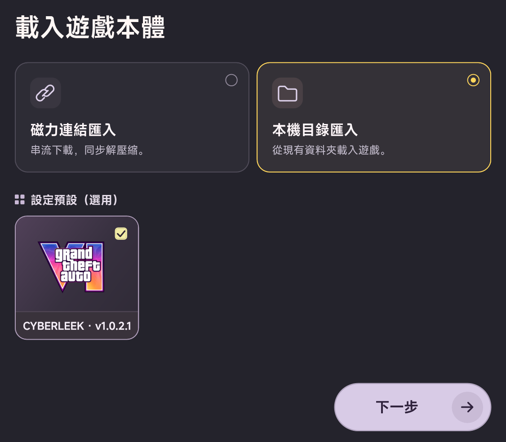
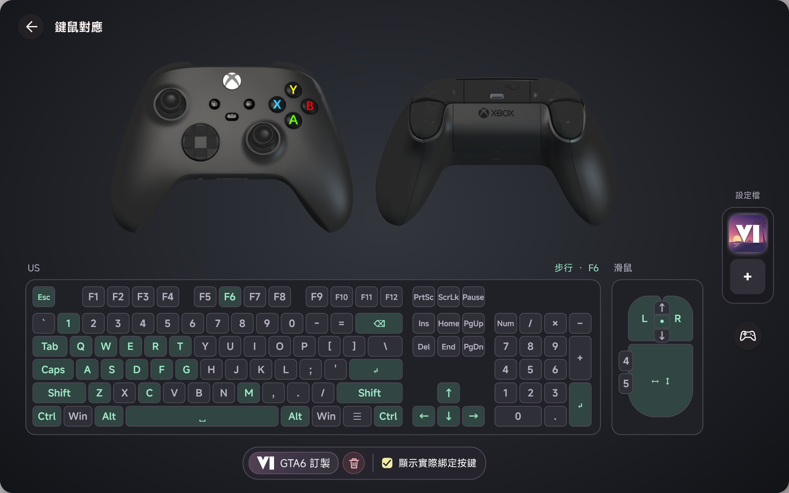

# Series Relay Launcher 使用者指南

[English](../README.md) · [简体中文](GUIDE.zh-CN.md) · 繁體中文 · [日本語](GUIDE.ja.md) · [한국어](GUIDE.ko.md)

Series Relay Launcher 是 Windows x64 上的遊戲執行個體啟動器。把已有的 Xbox Series 建置匯入遊戲庫後，你可以為每個執行個體選擇執行引擎、配置輸入，在大廳查看啟動狀態、遊玩記錄和成就。**內建預設適用於 CYBERLEEK · v1.0.2.1**。下文的專用鍵位、HUD 提示和成就目錄均以這個建置為準。

**[下載 Windows 可攜版 v1.0.4.2](https://github.com/Pumo-Ayla/series-relay-launcher/releases/download/v1.0.4.2/SRLauncher-1.0.4.2.zip)** · [最新發行版](https://github.com/Pumo-Ayla/series-relay-launcher/releases/latest) · [逐版更新說明](../Updates/RELEASE.md) · [再開發說明](DEVELOPMENT.zh-TW.md)

## 支援的模擬器與相容層

| 發行包中的引擎 | 在哪裡選 | 此版本提供的功能 |
| --- | --- | --- |
| cool_fox（CGBJ） | 獨立優化執行個體的啟動選項 | 自訂鍵鼠對應、遊戲內鍵位重繪、著色器與管線預熱、本機成就事件 |
| VIctory-NVIDIA | 獨立優化執行個體的啟動選項 | 原生預載、渲染設定、按硬體能力開放的 DLSS / FSR 影格生成、本機成就事件 |
| XCL（Xbox Series X\|S） | 通用執行個體的 XCL 配置 | 通用啟動、XCL 預熱及 XCL 存檔管理。具體建置能否執行還取決於引擎。 |

## 獨立最佳化遊戲清單

| 內建預設 | 對應建置 | 選擇後會發生什麼 |
| --- | --- | --- |
| **CYBERLEEK · v1.0.2.1** | Xbox Series，資訊清單的 TitleId 為 `7952987A` | 自動配置執行個體的名稱、圖示、詳細資料卡和大廳，開放 cool_fox 與 VIctory-NVIDIA。遊戲資源仍須從自己的目錄或下載來源載入。 |

## 如何載入遊戲

### 開啟遊戲庫並選擇來源

1. 將啟動器 ZIP 完整解壓縮到可寫目錄，按兩下 **`SRLauncher.exe`**。首次介面為英文。點選右上角齒輪，在語言選項中選擇「繁體中文」。
2. 點選左側 **＋**，選擇「本機目錄匯入」或「磁力連結匯入」。如果你持有 **CYBERLEEK · v1.0.2.1**，可同時選取下方的同名預設。它會填好執行個體名稱、圖示、詳細資料卡和大廳外觀。
3. 點選右下角「下一步」。左側三點圖示代表正在配置的新執行個體。在這一頁勾選預設後，仍需選擇一種匯入來源。根據手中已有的檔案，按下面對應的步驟繼續。

| 手頭的檔案 | 匯入時怎么選 |
| --- | --- |
| 已解壓縮的遊戲目錄 | 選擇遊戲資源所在目錄。啟動器檢查清單、必要資源和 EXE。 |
| 單個壓縮包或分卷歸檔 | 將分卷放在同一目錄，讓啟動器識別主卷，選好解壓縮目標目錄。「直接解壓」保留原包，可從頭重試。 |
| 磁力連結 | 檢查下載來源後，根據檔案清單區分散裝檔案和壓縮包。歸檔需要設定解壓縮目錄，安裝進度會在入庫後顯示。 |
| 遊戲 EXE 單獨存放 | 在 EXE 來源頁面指定本機檔案或介面支援的壓縮包、磁力連結。版本匹配時也可以從內建列表選取。 |

### 已解壓縮的目錄

1. 點選「遊戲本體目錄」旁的「選擇」，找到含有 `MicrosoftGame.Config` 的資料夾。例如清單在 `D:\Games\Example\GameData\MicrosoftGame.Config`，可選 `GameData` 或它的直接上一級 `Example`。同一硬盤放有多款遊戲時，請選到這一款自己的目錄。
2. 點選「檢查」。對於本頁的獨立優化建置，目錄還應有 `common.rpf`、`shaders.rpf`、`levels.rpf`、`textures.rpf`。錯誤訊息里若出現其中一個檔名，先核對選取的層級，再確認檔案已完整取得。
3. 在「本體中是否包含遊戲 EXE？」選擇「包含，自動尋找」，再按「檢查」。啟動器沿遊戲清單聲明的位置查找程式。若程式另存，選擇「另行提供 EXE → 自己的 EXE」並瀏覽到檔案，或選擇「內建適配 EXE」後點選對應版本。此建置的遊戲程式通常名為 `game_scarlett_master.exe`。
4. 看到「遊戲清單、必要資源和 EXE 均符合要求」後再按綠色按鈕。已勾選內建預設時按鈕為「完成」，直接生成執行個體。未勾選時為「下一步」，進入詳細配置。用已解壓縮目錄直接匯入時，執行個體引用所選檔案，載入後請保留它們的路徑。

### 本機 ZIP、7Z、RAR 或分卷包

1. 仍選「本機目錄匯入」。在資料夾選擇器里選**壓縮包所在目錄**。例如同目錄有 `Example.part01.exe`、`Example.part02.rar`、`Example.part03.rar`，三卷均應保留原名。這里的 `part01.exe` 是自解壓縮主卷，供啟動器讀取，遊戲 EXE 要在後面的步驟單獨確認。
2. 點選「檢查」。只有一套可識別的歸檔時會直接顯示包名和卷數。若目錄有多個候選，在彈出的選擇器里選需要匯入的主包或第一卷。若首卷缺失或編號有斷檔，先補齊檔案。
3. 回答「本體中是否包含遊戲 EXE？」。包內帶遊戲主程式時選「包含，自動尋找」。只有資源包時選「另外提供 EXE」，再選自己的檔案、包含主程式的 ZIP / RAR / 7Z，或對應的內建 EXE。
4. 選擇「直接解壓」並設定**解壓縮目錄**，適合需要保留原包或可能重試的情況。若選「邊解壓邊刪除」，閱讀黃色提示並勾選確認。分卷 RAR 在讀取下一卷時可能刪除已完整讀過的上一卷，單卷包在解壓縮完成並找到清單後才刪除。發生斷電、取消或校驗失敗時，重試前可能要重新取得已刪除的卷。兩種模式都需要選擇已存在、可寫的目標資料夾。
5. 檢查通過後完成入庫。看到「來源已檢查，加入後即可安裝」表示來源和安裝方案已登記。回到大廳，選取新執行個體，**點選「解壓安裝」**。等待解壓縮、清單和 EXE 校驗完成，隨後進入預載。

### 磁力連結

1. 選擇「磁力連結匯入」，粘貼完整的 `magnet:?` 連結。點「檢查」後頁面顯示「正在檢查下載來源」。這一步取得種子元資料，讀取檔名和目錄結構。網頁分享地址應先換成實際的磁力連結。
2. 若顯示「檢測到散裝遊戲本體」，說明檔案清單中直接列有 `MicrosoftGame.Config`。若顯示「偵測到本體壓縮檔」，後續會要求選擇解壓縮方式與解壓縮目錄。僅憑壓縮包檔名無法確認包里帶有遊戲 EXE。
3. 按實際來源選擇「包含，自動尋找」或「另外提供 EXE」。磁力匯入中的「自己的 EXE」還可填寫 EXE / 壓縮包的 HTTP(S) 直鏈，或單獨的 EXE 磁力連結。填寫直鏈時應指向檔案本身；下載到登錄頁面或檔案分享頁面會導致格式檢查失敗。
4. 散裝本體在彈窗中選擇輸出目錄。歸檔則先選標準解壓縮或刪除源卷，再選解壓縮目錄。完成入庫後在大廳點 **「開始下載」**。磁力歸檔會先下載到目標位置，再按所選策略解壓縮；所需空間應計入下載檔案和解壓縮輸出。
5. 如果超過 60 秒取不到元資料，先確認連結完整、有在線來源。開始傳輸後出現「90 秒內未收到所需資料」表示該階段沒有取得所需資料，可檢查來源後重試。安裝按鈕旁的菜單可開啟所在資料夾，傳輸進行時還可取消。

### 自行配置與第一次啟動

自行配置時，填寫執行個體名稱，點名稱旁的圖示可更換圖示。封面和 Logo 可選 PNG、JPEG 或 BMP。左側可切換三種資料預覽，拖動 Logo 移動位置，拖動角點縮放。使用預設外觀也可繼續。選擇「設定啟動器」後點選「檢查」；若選擇「獨立最佳化」，還需點選版本行。檢查通過點「下一步」，在大廳背景頁選擇圖片或保留預設效果，最後點「完成」。

回到大廳後看右下角主按鈕。顯示「開始下載」或「解壓安裝」時，**還需要點選它**。顯示「管線預熱」時可查看詳情，等綠色「啟動遊戲」出現再點選。v1.0.4 會分別提示安裝完成、開始預載、預載完成和遊戲啟動成功；最後一項對應引擎報告的首幀。左側狀態條在匯入草稿上為白色、安裝中為藍色、預熱中為黃色、就緒或執行中為綠色。紅色表示當前執行個體尚不可啟動。遊戲執行時可瀏覽其他執行個體，狀態條留在執行中的執行個體上。

## 用鍵盤和滑鼠遊玩

在左下角**長按輸入圖示**切換到鍵鼠模式，再**單擊**開啟「鍵鼠對應」。使用內建鍵位時，選取帶 VI 標識的預設即可。想改鍵時，點配置槽的 **＋**，跟隨控制器上高亮的按鈕逐項輸入。輸入滑鼠鍵時，把指針放在白色輸入框內。完成最後一項後保存，可在配置槽之間切換。

內建鍵位按步行和駕駛分層。按 **F6** 切換兩層，避免同一個按鍵在錯誤的場景觸發。

| 場景 | 常用操作 |
| --- | --- |
| 步行 | WASD 移動，滑鼠右鍵瞄準，左鍵射擊。 |
| 駕駛 | W 加速，S 制動，A / D 轉向，空格手剎。 |
| 查看綁定 | 在對應頁切換控制器與鍵盤視圖，查看當前方案及按鍵回饋。 |

### 讓遊戲內提示顯示實際鍵位

在此預設下選擇 **cool_fox（CGBJ）**，啟用鍵鼠模式並選取一套完整配置。在對應頁勾選 **「顯示實際綁定按鍵」**（英文為 **Show bound keys in game**），等「正在準備鍵位提示」結束後啟動。支援的操作提示會顯示實際綁定，例如瞄準顯示滑鼠右鍵，跳躍顯示空格。改綁後請退出遊戲，讓啟動器按新方案重新準備。

遊戲 HUD 中的控制器按鈕會重繪成鍵帽，幫助文字里的操作標記也會隨之替換。處理範圍取決於該建置的圖示庫和文本資源。v1.0.4 通過 CGBJ 引擎應用自訂對應和 HUD 重繪。

**自行輸入時**，向導有 18 項，依次涵蓋面鍵、肩鍵、扳機、方向鍵、搖桿按下以及系統鍵。白色槽顯示剛輸入的鍵後點「下一步」。點回鍵位可以重錄。WASD 已保留給移動，滑鼠側鍵和滾輪也可用於支援的輸入項。已保存的非當前配置單擊即可切換，選取自己的配置後可再次進入編輯。內建方案中，方向鍵可導航菜單，Enter 確認，Backspace 返回，Esc 開啟暫停菜單，長按 Alt 切換角色。

### 檢查控制器輸入和幀率參考

在控制器模式下單擊左下角輸入圖示，開啟控制器輸入測試。依次按下按鈕、撥動搖桿、扣下扳機，觀察介面回饋。設備提供運動傳感器時，控制器視圖還會顯示姿態變化。

設定里的「顯示遊戲幀率參考」會在引擎專案卡中列出上游報告的幀率與測試場景。比較不同專案時請同時看測試硬體和場景。本次啟動過程的實際情況可在實時日誌中查看。

## 查看成就與遊玩記錄

按一下「成就紀錄」旁的格狀圖示即可切換至**成就總覽**。每個方塊代表一項成就，依數字 ID 排列。已解鎖的方塊會顯示獎盃色，其餘維持暗色。將游標移至方塊上可查看 ID、名稱和狀態，再按清單圖示即可返回卡片。

在**設定 → 通知音效**中，可以逐項選擇音效，按**試聽**即可聆聽。成就進度更新預設為靜音，解鎖時會播放成就鈴音。安裝完成、開始預載、預載完成、遊戲啟動、操作確認和失敗也各有音效。關閉**播放通知音效**會保留各項選擇，下次開啟時繼續使用。控制器連線與中斷可分別設定提示音，通知會顯示對應的控制器名稱。

展開大廳左下角的遊戲詳細資料卡，可以查看遊戲進度、遊玩時長、上次啟動時間和成就記錄。**單擊成就卡**可展開名稱、達成條件以及已記錄的首次達成時間。未完成的卡片顯示已記錄的進度，已完成的卡片帶勾。

遊玩期間，**SR Achievement Event Monitoring System** 會讀取當前執行個體的本機執行事件。首次觀察到更高進度時顯示進度提示，達到 100% 時顯示完成通知。這個預設的目錄共 **55 項**。記錄歸屬於當前啟動器執行個體，顯示的是本機觀察到的進度。

## 引擎、預熱與故障排查

### 存檔、備份與執行個體管理

在「啟動選項」開啟「本機存檔」或「XCL存檔」。選取的槽決定下一次啟動使用哪組資料。退出遊戲後可「匯出存檔」生成 ZIP，再用「匯入存檔」添加外部備份。詳細資料卡的劇情名稱和百分比來自可讀的劇情存檔；成就按工作階段日誌歸集。還原劇情備份後，兩種記錄可能處于不同時間點。

要從側欄移除一個執行個體，右鍵遊戲圖示並選擇「僅移除啟動器實例」或「移除實例並刪除遊戲檔案」。前者保留本體和存檔。後者的確認框會顯示將被刪除的目錄，可先核對路徑。若其他執行個體也引用該目錄、目標涉及系統或啟動器資料，刪除遊戲檔案的操作會被禁用。

### 如何判斷應當等、重試還是補檔案

| 你看到的情況 | 可以做什麼 |
| --- | --- |
| 想切換執行引擎 | 從大廳的「啟動選項」選擇當前執行個體提供的引擎。CYBERLEEK 預設對應 cool_fox 和 VIctory-NVIDIA，通用配置使用 XCL。發行包所用的具體提交見[模擬器清單](../Emulators/catalog.json)。 |
| 啟動按鈕顯示「管線預熱」 | 查看按鈕的預熱詳情。「快取中的著色器」是著色器數量，「已處理管線」是本輪已經處理和待處理的渲染管線數。二者計數對象不同。重複啟動仍可能有管線準備階段，請以本次進度為準。 |
| 想調整畫質或插幀 | 開啟所選引擎的渲染設定。可用的超解析度、影格生成和倍率由引擎版本與顯卡共同決定。專案首頁記錄了各代硬體的限制，儲存庫內的引擎版本由發行清單固定。[VIctory-NVIDIA 上游說明](https://github.com/trustno1-coder/VIctory-NVIDIA) |
| 啟動器提示缺少執行元件 | 開啟「設定 → 執行環境 → 檢測」。啟動器按內建元件索引校驗檔案，並嘗試從本機元件庫還原缺失或損壞的元件。若仍有錯誤，點右上角終端圖示查看實時日誌。 |
| 回報黑畫面、預熱停滯或成就未記錄 | 以滑鼠右鍵按頂端的終端機圖示，選擇「匯出完整診斷記錄」，傳送產生的 `SR-Diagnostics-*.log`。檔案包含本次和上次工作階段、各次嘗試的引擎記錄、硬體與驅動程式，以及下載、元件和更新記錄。 |

## 下載與更新

**全新安裝**　下載 [SRLauncher-1.0.4.2.zip](https://github.com/Pumo-Ayla/series-relay-launcher/releases/download/v1.0.4.2/SRLauncher-1.0.4.2.zip)，完整解壓縮至可寫入的資料夾，執行 `SRLauncher.exe`。首次啟動使用英文。

**從 1.0.4 或更早版本升級**　舊版僅辨識三段版本號。下載[離線升級包](https://github.com/Pumo-Ayla/series-relay-launcher/releases/download/v1.0.4.2/SRLauncher-1.0.4.2-offline.zip)，解壓縮到另一個暫存資料夾，保留內層 ZIP。關閉遊戲與啟動器，執行 `Upgrade-Launcher.exe`，輸入原本存放 `SRLauncher.exe` 或 `Launcher.exe` 的資料夾。完成後從原資料夾啟動，遊戲實例、設定及存檔會保留。

**後續更新**　從 1.0.4.1 起，在啟動時及每次按下「檢查更新」時各查詢一次。下載和重試使用該次查詢結果，並驗證大小與 SHA-256。本次為一般更新，可略過。發行頁的 **Source code (zip)** 供再開發使用。

## 許可

本專案原創且有權授權的代碼和文檔采用 [CC BY-NC 4.0](../LICENSE)。模擬器、執行庫、遊戲素材和商標遵循各自權利人的許可。各引擎的來源、提交和隨附許可可從[模擬器清單](../Emulators/catalog.json)和[上游源碼目錄](../Source/Community)查閱。
